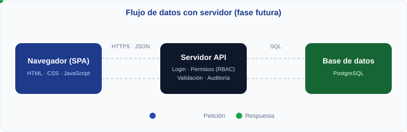

# SIA-Net · Sistema de Información Académica

Prototipo académico de una interfaz para la **I.E. N.° 86002 “Jorge Basadre Grohmann”**, ubicada en Nicrupampa, Independencia, Huaraz, Áncash. El alcance de la demostración comprende **Secundaria, de 1.º a 5.º grado**.

> **Solo es un prototipo con datos ficticios.** No es una plataforma oficial, no cuenta con autorización institucional y no se conecta con sistemas de la institución ni del Minedu. Los nombres, DNI, estudiantes, docentes, registros y horarios son de demostración.

## Cómo utilizarlo

1. Descarga el repositorio o clónalo en tu computadora.
2. Abre `index.html` en un navegador moderno. No requiere instalación de paquetes ni servidor.
3. Selecciona un perfil: **Administrativo**, **Docente** o **Apoderado**. El ingreso no utiliza contraseñas.
4. Recorre los módulos del menú lateral y prueba los registros.
5. Usa **Descargar PDF** en los módulos que ofrecen reportes.

**Los cambios solo se guardan en la memoria de la pestaña.** Se mantienen al cambiar de módulo o de perfil dentro de la misma página, pero desaparecen al recargarla o cerrarla. No se utiliza una base de datos, `localStorage` ni una API.

## Funciones disponibles

| Módulo | Funciones del prototipo |
|---|---|
| Inicio | Indicadores de demostración y comunicados recientes según el perfil. |
| Matrículas y grados | Consulta de 330 estudiantes ficticios; búsqueda por nombre o DNI; filtros por grado, sección y estado; ficha del estudiante; paginación; exportación CSV y PDF. |
| Docentes | Consulta de 10 docentes ficticios, especialidades y aulas asignadas. |
| Horario escolar | Horario semanal referencial por grado y sección, cursos con colores, turno tarde y exportación PDF. |
| Asistencias | Registro diario con botones de **Presente**, **Tardanza** y **Ausente**; guardado temporal y reporte PDF. |
| Calificaciones | Boleta por estudiante con **28 competencias**, cuatro bimestres, niveles de logro y conclusiones descriptivas. |
| Justificaciones | Creación de solicitudes por el apoderado y aprobación o rechazo por el administrativo. |
| Comunicados | Publicación por el administrativo y consulta según los perfiles destinatarios. |
| Notificaciones | Panel de comunicados con estados leído/nuevo, contador y opción para marcar todos como leídos. |

### Perfiles y accesos

| Módulo | Administrativo | Docente | Apoderado |
|---|---|---|---|
| Inicio | General | Su aula de demostración | Hijo seleccionado |
| Matrículas y grados | Consulta y exportación | — | — |
| Docentes | Consulta | — | — |
| Horario escolar | Consulta por grado y sección | Consulta por grado y sección | Horario de cada hijo vinculado |
| Asistencias | Todas las aulas | Registro en 3.º A | Porcentaje de asistencia en Inicio |
| Calificaciones | Registro por estudiante y aula | Registro en sus aulas de demostración | Boleta de cada hijo, en lectura |
| Justificaciones | Revisar, aprobar o rechazar | — | Crear y consultar las del hijo seleccionado |
| Comunicados | Crear y consultar | Consultar los dirigidos a su perfil | Consultar los dirigidos a su perfil |

Los permisos del menú se simulan con JavaScript. **No representan una barrera de seguridad real**: el navegador contiene los datos y la lógica del prototipo.

### Horarios escolares

- Se organizan de **lunes a viernes**, por grado y sección.
- Las clases comienzan a las **2:00 p. m.** y finalizan a las **7:45 p. m.**
- Los bloques de clase duran 45 minutos.
- El recreo está previsto de **4:15 a 4:45 p. m.**
- Cada curso tiene un color para facilitar su identificación.
- El apoderado de demostración tiene **tres hijos vinculados**, en **3.º A, 1.º B y 5.º C**. Puede alternar entre ellos y descargar el horario correspondiente.

Los horarios se calculan a partir de una matriz de cursos de ejemplo. **No son horarios oficiales ni incluyen validación de disponibilidad o cruces entre docentes.**

### Asistencia mediante botones

| Estado | Color | Identificación |
|---|---|---|
| Presente | Verde | ✓ Presente |
| Tardanza | Amarillo | ◷ Tardanza |
| Ausente | Rojo | ✕ Ausente |

Cada estudiante tiene un único estado seleccionado para la fecha. Los botones incluyen texto y estado accesible, además del color. Los cambios se aplican al pulsar **Guardar asistencia**.

### Boleta por competencias y bimestres

La boleta toma como referencia visual un informe de progreso del estudiante y organiza la evaluación por **área curricular, competencia y cuatro bimestres**.

| Nivel | Descripción |
|---|---|
| AD | Logro destacado |
| A | Logro esperado |
| B | En proceso |
| C | En inicio |
| — | Sin evaluar |

Incluye 28 competencias distribuidas entre las áreas de Secundaria y las competencias transversales. El primer bimestre contiene niveles ficticios; los demás comienzan sin evaluar. Las conclusiones descriptivas se registran para el bimestre seleccionado.

El administrativo y el docente pueden editar y pulsar **Guardar boleta**. El apoderado consulta la información de cada hijo. Para descargar el PDF, primero deben guardarse los cambios pendientes.

**Los niveles literales no se promedian.** La boleta es referencial y no constituye un documento oficial, una validación del Minedu ni una integración con SIAGIE.

Referencia de la escala: [publicación del Ministerio de Educación sobre niveles AD, A, B y C](https://www.gob.pe/institucion/minedu/noticias/880490-colegios-utilizaran-este-ano-escala-literal-para-calificar-a-estudiantes).

## Estructura del repositorio

```text
.
├── index.html          # Aplicación: HTML, estilos y JavaScript integrados
├── style.css           # Archivo de estilos adicional; index.html no lo enlaza actualmente
├── README.md           # Documentación del prototipo
└── assets/
    ├── paleta.svg      # Referencia visual de colores del README
    └── flujo.svg       # Flujo de datos del prototipo
```

La carpeta se llama **`assets`**. Sus imágenes documentan el proyecto; no son necesarias para ejecutar la aplicación. La interfaz principal está implementada en `index.html`.

## Cómo funciona el código

El proyecto utiliza **HTML, CSS y JavaScript nativo**, sin frameworks. Funciona como una SPA: cambia el contenido de la vista mediante el DOM sin cargar una página distinta por módulo.



### Arreglos de objetos en JavaScript

Los datos se almacenan en **arreglos (`arrays`) de objetos**. El sufijo `DB` identifica las colecciones de la demostración; **no significa que exista una base de datos real**.

| Arreglo | Contenido |
|---|---|
| `estudiantesDB` | 330 estudiantes: 5 grados × 3 secciones × 22 estudiantes. |
| `docentesDB` | 10 docentes ficticios y sus aulas asignadas. |
| `asistenciasDB` | Estudiante, fecha y estado de asistencia. |
| `competenciasDB` | Estudiante, área, competencia, bimestre, nivel y conclusión descriptiva. |
| `justificacionesDB` | Solicitudes, motivos y estados de revisión. |
| `comunicadosDB` | Títulos, contenidos, fechas y perfiles destinatarios. |
| `calificacionesDB` | Datos numéricos de la versión inicial que todavía conserva el código; la nueva boleta utiliza `competenciasDB`. |

Ejemplo ilustrativo de un registro de competencia:

```js
{
  estudianteId: 'E001',
  area: 'Matemática',
  competencia: 'Resuelve problemas de cantidad',
  bimestre: 1,
  nivel: 'A',
  conclusion: 'Explica las estrategias que utiliza.'
}
```

Las colecciones se consultan mediante métodos como `filter()`, `find()` y `map()`. Los registros se agregan o actualizan en memoria. La relación con el estudiante se realiza mediante `estudianteId`.

### Datos aleatorios y reproducibilidad

`generarDatosIniciales()` crea los datos ficticios al cargar la página. Utiliza un generador **pseudoaleatorio con semilla fija (`20260`)**, por lo que los nombres y otros datos de ejemplo se generan de forma reproducible. No se consulta información real de alumnos.

No todo se genera al azar:

- Los comunicados y algunas solicitudes parten de ejemplos predefinidos.
- Las fechas de asistencia se calculan a partir de la fecha local del navegador.
- `inicializarCompetencias()` asigna niveles ficticios mediante un patrón determinista.
- `horarioAula()` adapta una matriz predefinida (`PLAN`) según grado y sección.
- La vinculación de los tres hijos del apoderado está predefinida para la demostración.

Por eso, **recargar restablece la demostración; no genera necesariamente una población diferente cada vez**.

### Interfaz y exportaciones

- `PERMISOS` y `puedeAcceder()` controlan las vistas disponibles para cada perfil.
- Las funciones de renderizado construyen las vistas mediante nodos DOM.
- Los textos ingresados por el usuario se insertan como texto, sin interpretarlos como HTML.
- Los reportes PDF se generan en el navegador con JavaScript, sin una librería externa de PDF.
- Las tablas PDF ajustan los textos largos y repiten los encabezados al cambiar de página.
- La exportación de matrículas genera un archivo **CSV**, que puede abrirse en Excel; no genera un archivo `.xlsx`.
- `LOGO_URL` configura una imagen externa. Si no carga, se mantiene el símbolo de libro. Su carga requiere conexión a internet.

## Colores de la interfaz



| Uso | Color |
|---|---|
| Menú lateral y texto principal | `#0f172a` |
| Botones principales y títulos | `#1e3a8a` |
| Botones al pasar el cursor | `#2749b5` |
| Fondo general | `#f8fafc` |
| Bordes | `#e2e8f0` |
| Presente / aprobado | `#dcfce7` y `#166534` |
| Tardanza / pendiente | `#fef9c3` y `#854d0e` |
| Ausente / rechazado | `#fee2e2` y `#991b1b` |

Esta paleta es una propuesta visual del prototipo y no representa una identidad institucional oficial.

## Limitaciones actuales

- No hay backend, base de datos, autenticación real ni contraseñas.
- Los cambios y las notificaciones leídas se pierden al recargar.
- Las pestañas o computadoras no comparten datos.
- La matrícula es una consulta: todavía no permite realizar un proceso completo de inscripción.
- La estructura académica y los periodos no tienen administración completa.
- No se ha implementado el registro de conducta ni la alerta automática por tres faltas injustificadas consecutivas.
- Aprobar una justificación cambia su estado, pero no modifica la asistencia vinculada.
- No hay auditoría inalterable, firma digital, validación oficial de boletas ni flujo formal de rectificación de notas.
- No se acreditan disponibilidad en la nube ni capacidad para 300 usuarios simultáneos.

## Próximos pasos

1. Incorporar una API y una base de datos para conservar y compartir los registros.
2. Implementar autenticación y autorización en el servidor.
3. Administrar usuarios, vínculos entre apoderados e hijos, matrículas y periodos escolares.
4. Relacionar las justificaciones aprobadas con las faltas y desarrollar las alertas de ausentismo.
5. Incorporar conducta, historial de cambios y validación de informes de progreso.
6. Validar horarios, asignaciones docentes y reglas académicas con los responsables de la institución.

Publicar este repositorio en GitHub o servirlo como sitio estático **no convierte los arreglos en una base de datos ni agrega un servidor de aplicación**. Continuará funcionando como una demostración en el navegador.
