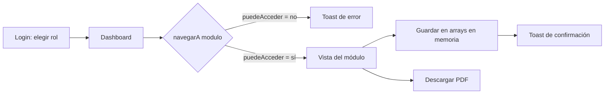
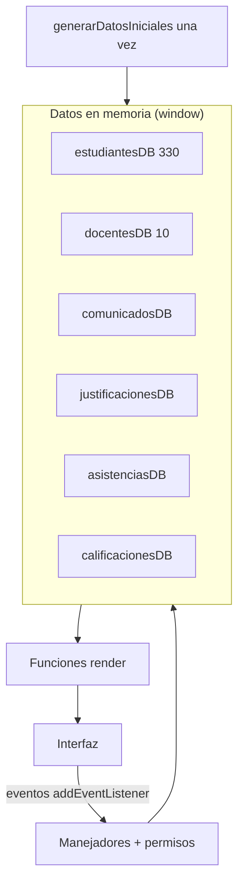
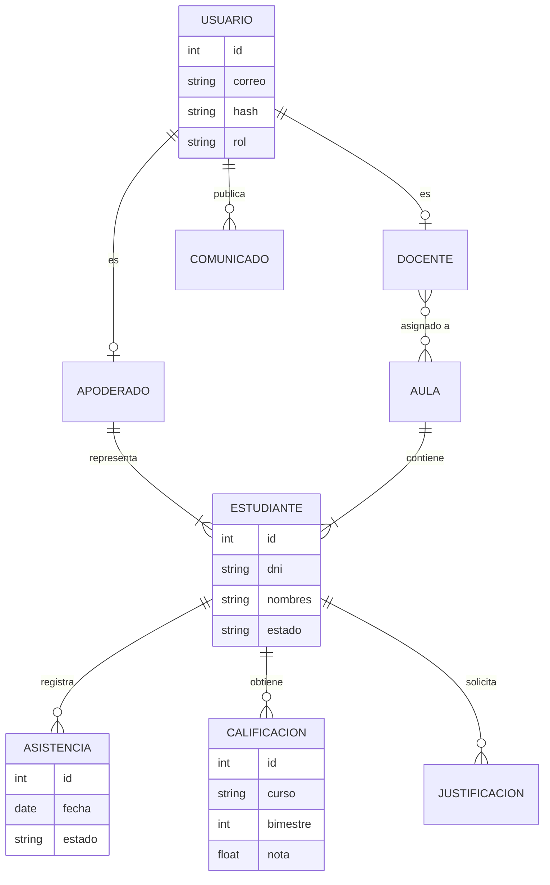
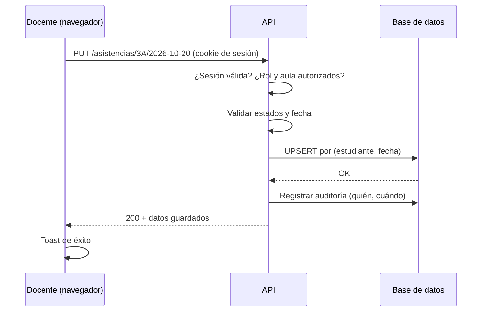
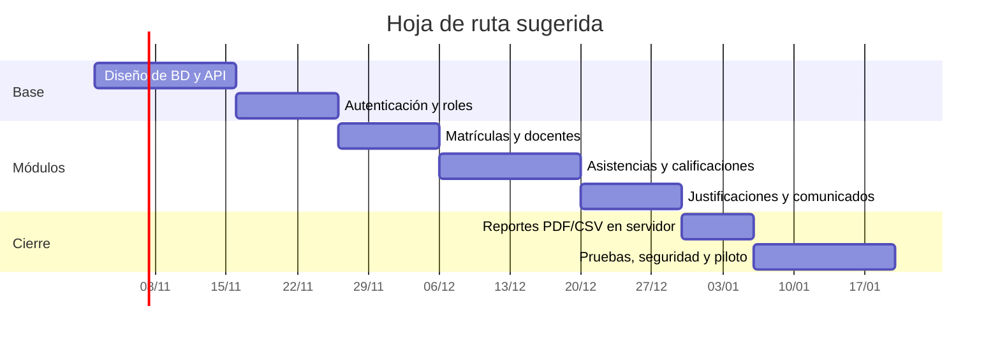

# SIA-Net · Sistema de Información Académica

Prototipo académico para la **I.E. N.° 86002 “Jorge Basadre Grohmann”** (Nicrupampa · Independencia · Huaraz · Áncash), alcance **Secundaria 1.º–5.º**.

> ⚠️ **Datos ficticios.** No es una plataforma oficial, no cuenta con autorización institucional y no se conecta a los sistemas de la institución. Los 330 estudiantes son población simulada.

---

## 1. Qué es y cómo se usa

Un único archivo `index.html` (HTML + CSS + JavaScript, sin frameworks ni servidor). Se abre con doble clic.

1. Elige un rol en el login: **Administrativo**, **Docente** o **Apoderado** (no hay contraseñas).
2. Navega por el menú lateral; cada rol ve solo sus módulos.
3. Los cambios (asistencias, notas, justificaciones, comunicados) viven **en memoria**: al recargar, la demostración se restablece.
4. En los módulos con tabla, el botón **Descargar PDF** genera un reporte.

| Módulo | Administrativo | Docente | Apoderado |
|---|---|---|---|
| Inicio | Sí | Sí | Sí |
| Matrículas y grados | Sí | No | No |
| Docentes | Sí | No | No |
| Asistencias | Todas las aulas | Solo 3.º A | No |
| Calificaciones | Todas las aulas | Solo 3.º A | Solo su estudiante (lectura) |
| Justificaciones | Revisar | No | Crear y consultar las propias |
| Comunicados | Consultar y crear | Consultar | Consultar |

---

## 2. Colores y para qué sirven

| Color | Código | Dónde se usa |
|---|---|---|
| Sidebar | `#0f172a` | Menú lateral y texto principal. Transmite sobriedad y da contraste. |
| Azul corporativo | `#1e3a8a` | Botones principales, módulo activo, títulos y cabecera de tablas en PDF. |
| Azul hover | `#2749b5` | Estado al pasar el cursor sobre botones. |
| Fondo | `#f8fafc` | Fondo general; las tarjetas blancas resaltan encima. |
| Bordes | `#e2e8f0` | Líneas de tarjetas, tablas y campos. |
| Verde (`#dcfce7` / `#166534`) | — | Estados favorables: *Matriculado, Presente, Aprobada*. |
| Amarillo (`#fef9c3` / `#854d0e`) | — | Pendientes: *Tardanza, Pendiente*. |
| Rojo (`#fee2e2` / `#991b1b`) | — | Alertas: *Retirado, Ausente, Rechazada*, campos inválidos. |

Regla simple: **verde = bien, amarillo = atención/pendiente, rojo = alerta**. El color nunca es la única señal: cada badge incluye texto. Es una propuesta visual del prototipo, no la identidad oficial del colegio.

---

## 3. Cómo funciona por dentro

- **Relaciones:** asistencias, notas y justificaciones apuntan al estudiante por `estudianteId`; guardar actualiza el registro existente, sin duplicados.
- **Seguridad de interfaz:** los textos de usuario se insertan con `textContent`, nunca con `innerHTML`.
- **Permisos:** objeto `PERMISOS` + `puedeAcceder()`, comprobado al navegar y antes de guardar.
  **Esto es solo una simulación de interfaz: en una aplicación real la autorización debe validarse en el servidor.**
- **PDF:** generador propio en JavaScript puro; Matrículas exporta todos los resultados filtrados.
- **Logo:** constante `LOGO_URL` opcional; si falta o no carga, se usa un símbolo de libro SVG.

---

## 4. Plan para pasar a nivel servidor

### 4.1 Arquitectura propuesta

| Capa | Propuesta |
|---|---|
| Frontend | Mantener la SPA; reemplazar los arrays por llamadas `fetch` a la API. |
| API | Node.js con Fastify o Express, rutas REST bajo `/api/v1`. |
| Base de datos | PostgreSQL con migraciones (Prisma o similar). |
| Autenticación | Sesión con cookie `HttpOnly` + `Secure` + `SameSite`; contraseñas con Argon2. |
| Validación | Esquemas (zod) en cada endpoint. |
| Despliegue | Contenedor Docker, HTTPS, copias de seguridad automáticas. |

### 4.2 Modelo de datos

Restricciones clave: `dni` único, `UNIQUE(estudiante, fecha)` en asistencias y `UNIQUE(estudiante, curso, bimestre)` en notas (el equivalente servidor de “sin duplicados”).

### 4.3 Endpoints principales

| Método | Ruta | Permiso |
|---|---|---|
| POST | `/auth/login`, `/auth/logout` | Público / sesión |
| GET | `/estudiantes?grado&seccion&estado&q&pagina` | Administrativo |
| GET | `/estudiantes/export.csv` | Administrativo |
| PUT | `/asistencias/:aula/:fecha` | Administrativo; docente de esa aula |
| PUT | `/calificaciones/:aula/:curso/:bimestre` | Administrativo; docente de esa aula |
| GET | `/mis-hijos/calificaciones` | Apoderado (solo su estudiante) |
| POST/PATCH | `/justificaciones`, `/justificaciones/:id` | Apoderado crea; administrativo resuelve |
| GET/POST | `/comunicados` | Según rol |
| GET | `/reportes/:modulo.pdf` | Según módulo |

### 4.4 Guardado seguro (ejemplo)

### 4.5 Fases

### 4.6 Seguridad y cumplimiento

- Autorización **siempre en el servidor** (el RBAC del prototipo no protege nada por sí solo).
- Protección de datos personales de menores: minimizar datos, cifrar en tránsito, definir retención y accesos; revisar la normativa peruana de protección de datos personales con el área legal de la institución.
- Registro de auditoría de cambios en notas y asistencias; copias de seguridad probadas.
- Pruebas automáticas de permisos (cada rol intenta acceder a lo que no debe).
- Cualquier integración con sistemas oficiales (por ejemplo, del Minedu) requiere **autorización formal de la institución**; el prototipo no la asume.

---

## 5. Limitaciones actuales

- Todo se pierde al recargar (por diseño).
- No hay autenticación real ni contraseñas.
- Sin logo oficial verificado: se usa un símbolo neutro (configurable con `LOGO_URL`).
- Contactos y autoridades de la institución no se muestran porque no se verificaron en una fuente institucional.
